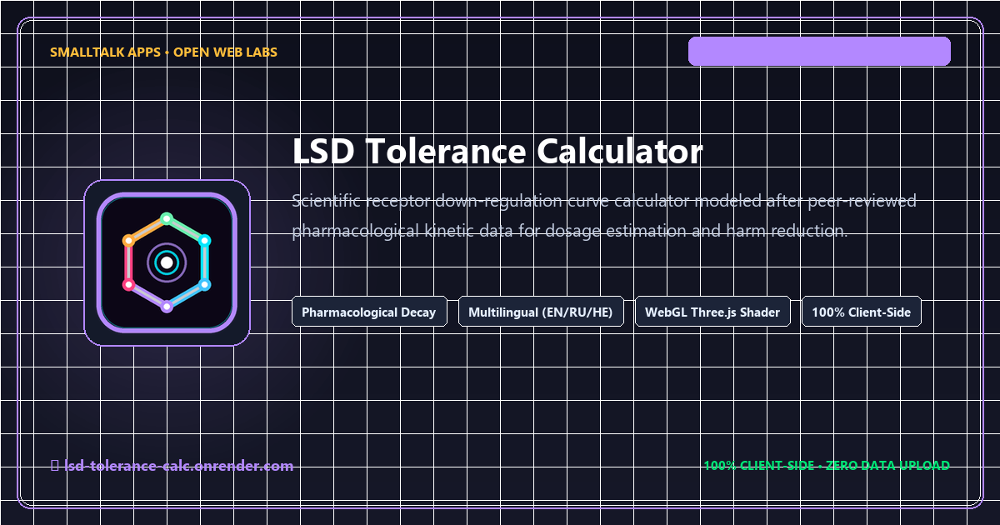

# 🧪 LSD Tolerance Model: Time-based Dosing Calculator

[](https://lsd-tolerance-calc.onrender.com/)
[](LICENSE)
[](https://lsd-tolerance-calc.onrender.com/)
[](index.html)
[](index.html)
[](CONTRIBUTING.md)

An interactive, educational single-page web application and harm-reduction visualizer designed to estimate required dose adjustments for LSD based on time elapsed since the last dose. It leverages a standard pharmacological kinetics model of rapid tachyphylaxis and 5-HT2A receptor downregulation, predicting a return to baseline receptor sensitivity over approximately seven days.

Hosted live on Render at **[https://lsd-tolerance-calc.onrender.com/](https://lsd-tolerance-calc.onrender.com/)**.

---



---

## 📑 Table of Contents

- [Project Overview](#-project-overview)
- [Key Features](#-key-features)
- [Pharmacological Model & Kinetics](#-the-tolerance-model-pharmacology)
- [Essential Harm Reduction Disclaimer](#-essential-disclaimer)
- [Technology Stack](#-technology-stack)
- [Project Structure](#-project-structure)
- [Local Development & Usage](#-local-development--usage)
- [SEO & Social Link Previews](#-seo--social-link-previews)
- [Community & Contributing](#-community--contributing)
- [Security Policy](#-security-policy)
- [License](#-license)

---

## 🌈 Project Overview

The **LSD Tolerance Model** provides an accessible, scientific interface for understanding psychedelic tachyphylaxis. In addition to pharmacokinetic calculations, the application features a responsive layout, multi-language internationalization (English, Russian, Hebrew with full RTL support), and a real-time WebGL background animation built with Three.js and custom GLSL fragment shaders.

---

## ✨ Key Features

- **⏱️ Time-Based Calculation**: Determines the required compensatory dose based on last dose time and target desired effect.
- **🌍 Multilingual & RTL Support**: Native toggle between English (`EN`), Russian (`RU`), and Hebrew (`HE`), including dynamic Right-to-Left layout flow.
- **🎨 Psychedelic WebGL Background**: Custom, high-efficiency GLSL fragment shader powered by Three.js rendering an ambient rainbow diffraction pattern.
- **📱 Fully Responsive**: Tailored for smartphones, tablets, and wide monitors with Tailwind CSS.
- **📊 Real-Time Feedback**: Instant visual indicator showing tolerance multiplier and physiological status (High, Moderate, Low, Baseline).
- **🔒 100% Client-Side**: Zero data transmission, zero cookies, zero external telemetry.

---

## 🧠 The Tolerance Model (Pharmacology)

The calculator models 5-HT2A receptor downregulation and upregulation recovery using a standard step-wise kinetic approximation:

| Time Elapsed | Tolerance Multiplier | Status Category |
| :--- | :--- | :--- |
| **< 12 hours** | ~3.5x | High Tolerance |
| **< 24 hours** | ~2.5x | High Tolerance |
| **< 48 hours** | ~1.8x | Moderate Tolerance |
| **< 72 hours** | ~1.4x | Moderate Tolerance |
| **< 96 hours** | ~1.2x | Low Tolerance |
| **< 120 hours** | ~1.1x | Low Tolerance |
| **< 144 hours** | ~1.05x | Trace Tolerance |
| **< 168 hours** | ~1.02x | Trace Tolerance |
| **7+ Days** | 1.0x (Full Reset) | Baseline Sensitivity |

### Calculation Formula

$$\text{Estimated Dose} = \text{Target Dose} \times M(t)$$

Where $M(t)$ represents the empirical tachyphylaxis multiplier decaying to $1.0$ at $t \ge 168\text{ hours}$.

---

## ⚠️ Essential Disclaimer

This tool is designed **exclusively for educational and harm-reduction research purposes**. Individual metabolism, receptor density, set, and setting vary substantially. **DO NOT USE THIS CALCULATOR TO DETERMINE RECREATIONAL DOSING.** The authors and SmallTalk Apps assume no liability for misuse.

---

## 💻 Technology Stack

- **HTML5 & CSS3**: Semantic foundation styled with Tailwind CSS utility classes.
- **JavaScript (ES6+)**: Pure client-side calculations, locale dictionary switching, and DOM orchestration.
- **Three.js & GLSL**: WebGL scene management and procedural fragment shader.
- **Deployment**: Render Cloud Static Host ([lsd-tolerance-calc.onrender.com](https://lsd-tolerance-calc.onrender.com/)).

---

## 🏛️ Project Structure

```
lsd_tolerance_calc/
├── index.html                   # Single-page web application & WebGL shader
├── og-preview.png               # 1200x630 Open Graph & Twitter Card social preview card
├── preview.png                  # Social preview mirror asset
├── favicon.ico                  # Multi-resolution binary (16, 24, 32, 48, 64px)
├── favicon-16x16.png            # 16x16 browser tab favicon
├── favicon-32x32.png            # 32x32 high-DPI browser tab favicon
├── apple-touch-icon.png         # 180x180 iOS Home Screen touch icon
├── android-chrome-192x192.png   # 192x192 Android PWA launcher icon
├── google4aaea02b9f3d6c9f.html  # Google Search Console ownership verification token
├── robots.txt                   # Search crawler directives referencing sitemap.xml
├── sitemap.xml                  # Canonical XML sitemap for Google Search Console
├── CONTRIBUTING.md              # Community contribution guidelines
├── CODE_OF_CONDUCT.md           # Contributor Covenant Code of Conduct
├── SECURITY.md                  # Security vulnerability reporting policy
├── LICENSE                      # MIT Open Source License
└── README.md                    # Project documentation
```

---

## ⚙️ Local Development & Usage

Because the application is completely client-side, no compilers or build runners are required.

### 1. Clone the repository
```bash
git clone https://github.com/tripping-alien/lsd_tolerance_calc.git
cd lsd_tolerance_calc
```

### 2. Run locally
Double-click `index.html` or launch any local web server:

```bash
# Python 3
python -m http.server 8000

# Or Node.js
npx serve .
```

Navigate to `http://localhost:8000`.

---

## 🔍 SEO & Social Link Previews

- **Canonical URL**: `https://lsd-tolerance-calc.onrender.com/`
- **Open Graph / Twitter Cards**: 1200x630 high-resolution branded preview card (`og-preview.png`).
- **Sitemap & Robots**: Full `sitemap.xml` and `robots.txt` configuration for Google Search indexing.
- **Structured Data**: Schema.org `WebApplication` JSON-LD specification.

---

## 🤝 Community & Contributing

Contributions to translations, accessibility, and documentation are welcome! Please review [CONTRIBUTING.md](CONTRIBUTING.md) and [CODE_OF_CONDUCT.md](CODE_OF_CONDUCT.md) before submitting a Pull Request.

---

## 🛡️ Security Policy

Please review our [Security Policy](SECURITY.md) to report vulnerabilities responsibly.

---

## 📄 License

This project is open-source under the **MIT License** — see the [LICENSE](LICENSE) file for terms.

Maintained by **[SmallTalk Apps](https://smalltalkapps.art/)**.
